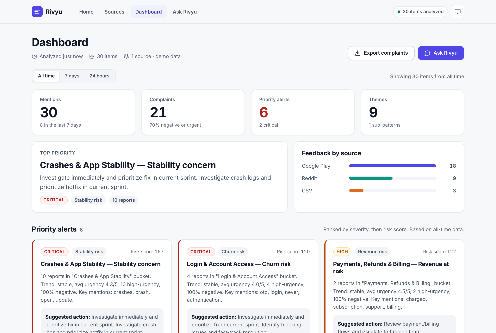
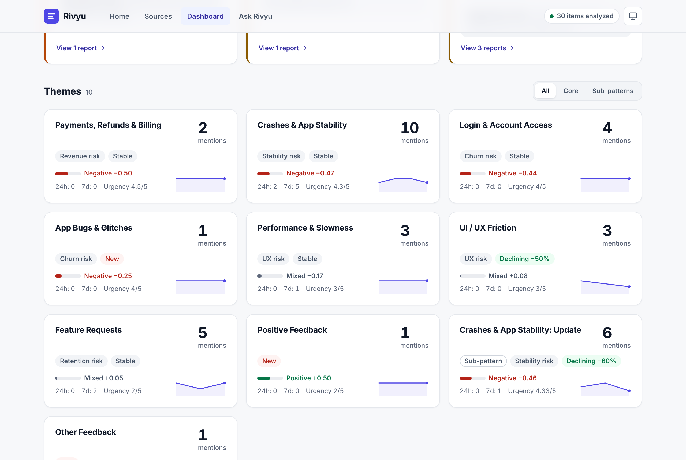
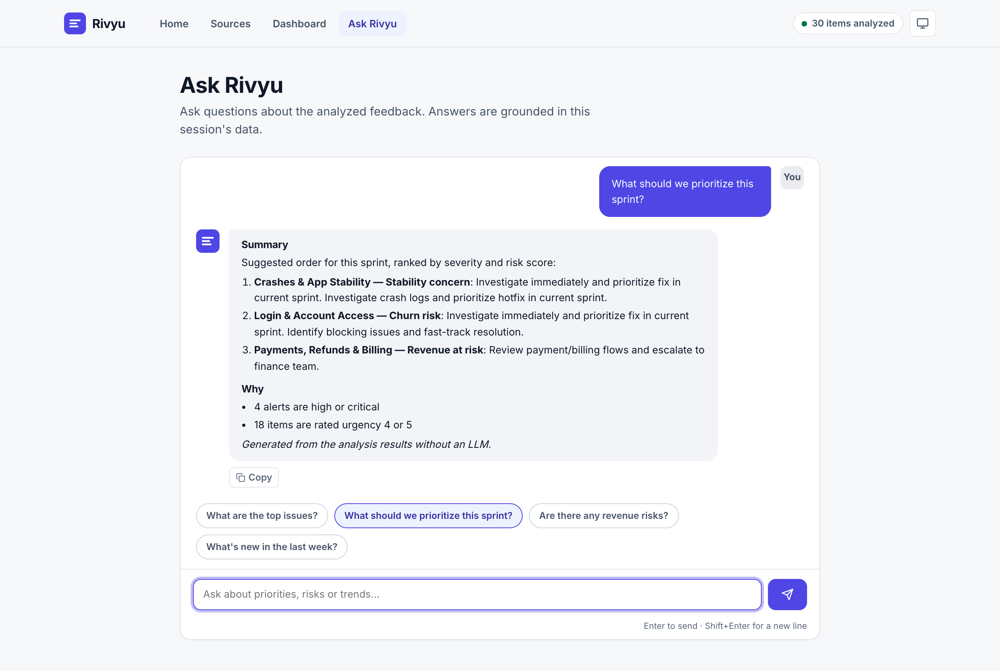
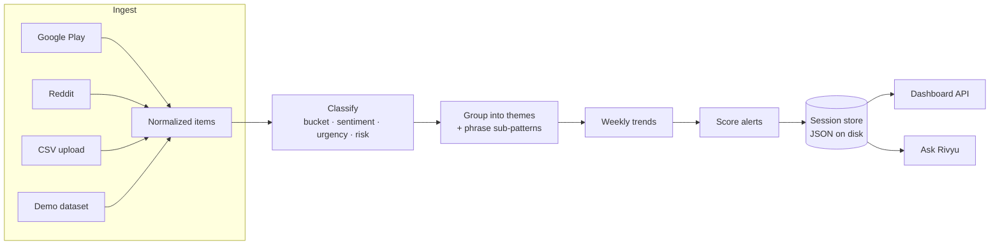

# Rivyu

[](https://github.com/dheera525/rivyu-product-feedback-clarity/actions/workflows/ci.yml)


[](LICENSE)

**AI product feedback analysis.** Rivyu pulls in app reviews, Reddit posts and support logs, classifies every item by topic, sentiment, urgency and business risk, groups them into themes with trends, raises priority alerts with suggested actions, and answers questions about the data in plain English.

**[Live demo → rivyu.onrender.com](https://rivyu.onrender.com)** (click **Try the demo**; the free tier may take up to a minute to wake up)



## Features

- **Sources**: Google Play reviews (by app ID or store URL), Reddit posts (by subreddit and optional search), CSV upload of support tickets or survey answers, and a built-in demo dataset. Gmail and X connectors are in progress and shown as *Coming soon*.
- **Analysis pipeline**: LLM classification into 16 product buckets with sentiment, urgency (1–5), risk tag and summary. It falls back to a keyword heuristic when no model is available, then groups items into themes and phrase-level sub-patterns, detects week-over-week trends, and scores alerts.
- **Dashboard**: 24h / 7d / all-time views, complaint rate, source breakdown, severity-ranked alerts with suggested actions, theme cards with sentiment and trend sparklines, a searchable and filterable evidence feed, and CSV export of complaints.
- **Ask Rivyu**: chat over the analyzed session ("What should we prioritize this sprint?"). Answers are grounded in the session's themes, alerts and the most urgent items.
- **Reliable by design**: every LLM call has a fallback, so the app still works with no API keys at all.

| Themes | Ask Rivyu |
| --- | --- |
|  |  |

## Architecture



**LLM fallback chain.** Each LLM call tries the next option if the previous one fails:

1. **Gemini 2.5 Flash** (if `GEMINI_API_KEY` is set). Quota errors pause Gemini for the duration the API suggests.
2. **OpenAI** (if `OPENAI_API_KEY` is set), trying `OPENAI_MODEL`, then `gpt-4o-mini`, `gpt-4.1-mini` and `gpt-4o`.
3. **Deterministic fallback**: keyword-based classification and data-driven Ask answers (revenue, praise, priorities, trends, top issues).

LLM output is validated (JSON shape, allowed buckets, clamped scores). Items the model drops or mislabels are filled in by the heuristic.

## Run locally

Requires Python 3.11+.

```bash
python3 -m venv .venv
source .venv/bin/activate
pip install -r requirements.txt
cp .env.example .env        # optional: add GEMINI_API_KEY and/or OPENAI_API_KEY
./run.sh
```

- App: http://localhost:8000
- API docs: http://localhost:8000/docs
- Health check: http://localhost:8000/api/health

Without API keys everything still runs, using the deterministic fallback.

### With Docker

```bash
docker build -t rivyu .
docker run --rm -p 8000:8000 -e GEMINI_API_KEY=... -e OPENAI_API_KEY=... rivyu
```

## Tests

```bash
pip install -r requirements-dev.txt
pytest
```

The suite covers classification fallbacks, theme grouping, trend detection, alert ordering, CSV parsing and validation, the HTTP API, the Ask fallback, and recovery from a corrupt or half-written store. All LLM calls are mocked, so tests run offline with no keys. CI ([`.github/workflows/ci.yml`](.github/workflows/ci.yml)) runs the tests and builds and smoke-tests the Docker image on every push and pull request.

## Project structure

```text
backend/
  main.py              FastAPI app: ingestion, analysis, dashboard, ask, export
  store.py             In-memory session store with atomic JSON persistence
  demo_data.py         30-item demo dataset (dates shifted to stay recent)
  ingest/              Source connectors (playstore, reddit, csv_upload; gmail, x, youtube in progress)
  pipeline/
    llm_client.py      Gemini → OpenAI fallback client
    classify.py        LLM + heuristic classification
    grouping.py        Theme and sub-pattern grouping
    trend.py           Weekly trend detection
    alerts.py          Risk scoring and alert generation
    ask_rivyu.py       Grounded Q&A with deterministic fallback
    run_pipeline.py    Orchestrates the steps above
frontend/              Vanilla HTML/CSS/JS served by FastAPI (no build step)
tests/                 pytest suite
docs/                  Screenshots and GitHub "About" text
Dockerfile, render.yaml
```

## Main API endpoints

| Method | Path | Purpose |
| --- | --- | --- |
| `POST` | `/api/ingest/playstore` | Add Google Play reviews (`app_id`, `count`) |
| `POST` | `/api/ingest/reddit` | Add Reddit posts (`subreddit`, `query`, `count`) |
| `POST` | `/api/ingest/csv` | Upload a CSV with a `text` column |
| `POST` | `/api/ingest/demo` | Replace the session with the demo dataset |
| `POST` | `/api/analyze` | Run the pipeline on the current session |
| `GET` | `/api/status` | Session state: `empty`, `ingested` or `analyzed` |
| `GET` | `/api/dashboard?time_filter=all\|7d\|24h` | Dashboard payload |
| `GET` | `/api/theme/{theme_id}` | Theme detail with all items |
| `POST` | `/api/ask` | Ask a question about the analyzed data |
| `GET` | `/api/export/complaints.csv` | Negative or urgent items as CSV |
| `POST` | `/api/reset` | Clear the session |

Full interactive docs are at `/docs`.

## Configuration

| Variable | Purpose |
| --- | --- |
| `GEMINI_API_KEY` | Primary LLM provider (optional) |
| `OPENAI_API_KEY` | Fallback LLM provider (optional) |
| `OPENAI_MODEL` | Preferred OpenAI model (optional) |
| `PORT` | Server port (default `8000`) |

Set secrets in your host's environment settings (on Render: **Environment**). Never commit `.env`.

## Deployment

`render.yaml` deploys the Docker image to Render with `/api/health` as the health check. See [DEPLOY.md](DEPLOY.md).

## Known limitations

- **One shared session.** All visitors share the same in-memory dataset, which suits a single-user demo. Multi-user use would need per-session or per-workspace storage.
- **Ephemeral storage.** On Render's free tier, data is cleared when the instance restarts or redeploys.
- **Analysis size.** A run analyzes up to 220 items to keep latency reasonable.

## License

[MIT](LICENSE)
